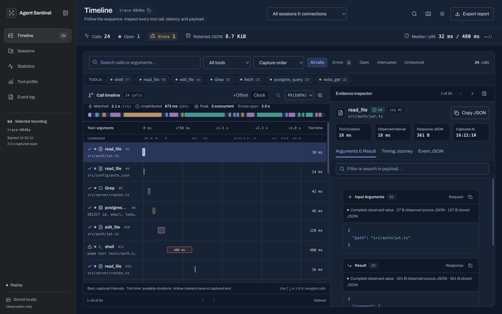
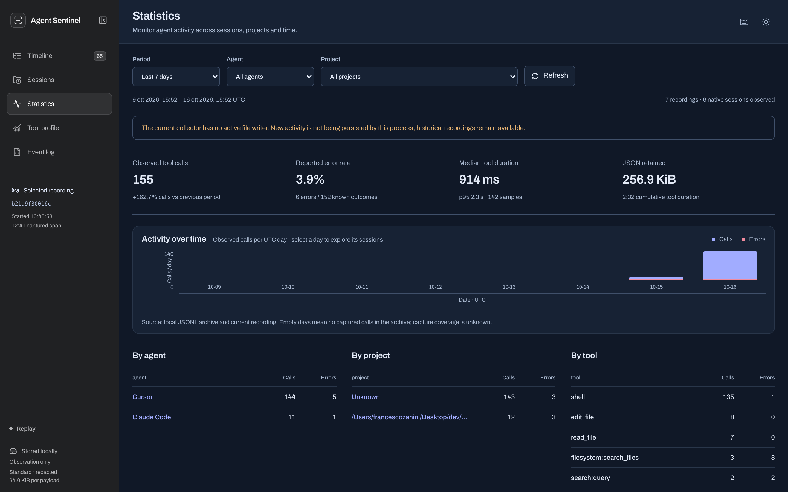
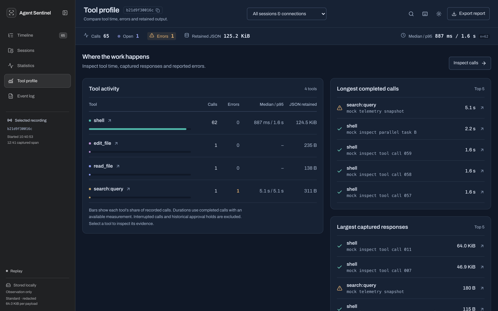
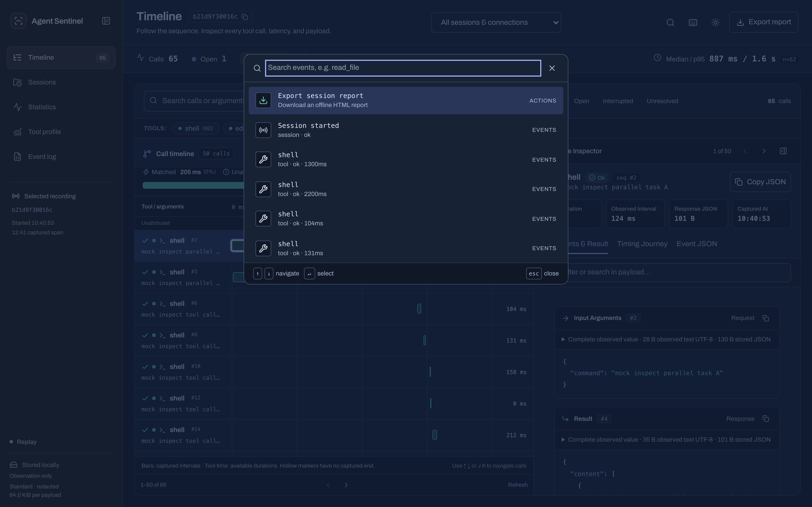
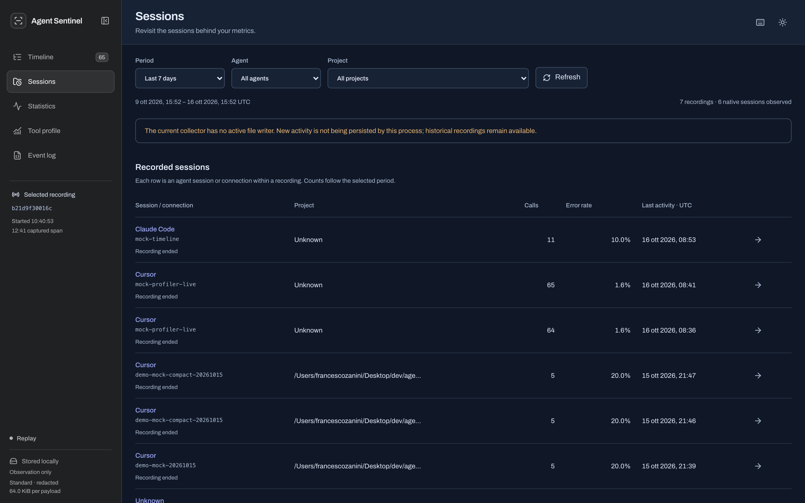

<div align="center">

# Agent Sentinel

### The Local Profiler & Flight Recorder for AI Agents

**Gain instant visibility into what your AI coding agents and MCP tools are actually doing.**  
Inspect every shell command, file edit, API payload, latency bottleneck, and error — 100% locally with zero cloud dependencies.

[](LICENSE)
[](https://go.dev/)
[](web/)
[](#architecture--design-principles)
[](#quickstart-in-30-seconds)

<br/>

<a href="#quickstart-in-30-seconds"><strong>Quickstart (30s)</strong></a> ·
<a href="#key-features"><strong>Features</strong></a> ·
<a href="#capture-profiles"><strong>Capture Profiles</strong></a> ·
<a href="#cli-reference"><strong>CLI Reference</strong></a> ·
<a href="#architecture--design-principles"><strong>Architecture</strong></a> ·
<a href="docs/ROADMAP.md"><strong>Roadmap</strong></a>

<br/>
<br/>

[](docs/screenshot-waterfall.png)
*The Agent Sentinel cockpit: Interactive call timeline waterfall, concurrency tracks, and real-time evidence inspector.*

</div>

---

## Why Agent Sentinel?

Modern AI coding agents (like **Cursor** and **Claude Code**) and **MCP (Model Context Protocol)** servers execute shell commands, patch local files, run background tasks, and query tools autonomously. 

Until now, understanding their actions meant squinting at fragmented terminal logs or trusting opaque status bars. When a tool fails, loops, or takes 15 seconds, you are left wondering: *What exact arguments were passed? Why did it hang? What diff was generated?*

**Agent Sentinel** solves this by acting as a passive, non-intrusive flight recorder:

- 🪶 **Zero Intrusion & Non-Blocking**: Runs locally via passive hooks with bounded 1s delivery deadlines. If Sentinel stops or crashes, your coding agent continues uninterrupted with neutral responses.
- ⏱️ **Full Call Observability**: Captures execution intervals, start/end timestamps, observed tool durations, and concurrency overlaps.
- 🔍 **Deep Evidence Inspector**: Inspect full request arguments, tool responses, structured error codes, file diffs, and redaction flags.
- 📊 **Historical Analytics**: Aggregates sessions across projects, daily UTC trends, p50/p95 latency percentiles, and error ratios.
- 🔒 **100% Local & Private**: Single Go executable with an embedded single-page cockpit. No accounts, no API keys, no Docker, and zero data leaves your machine.

---

## Key Features

### 1. Interactive Call Waterfall & Timeline
Navigate agent tool activity with proportional interval bars, concurrency indicators, and status tags (`Ok`, `Error`, `Open`, `Interrupted`). Filter by specific tools (`shell`, `read_file`, `edit_file`, MCP methods), text search inside arguments, and sort by duration or payload size.

<div align="center">
  
</div>

### 2. Deep Evidence Inspector
Click any call in the timeline to open the evidence panel. Inspect exact input arguments, output results, payload sizes, capture transformations, and the step-by-step timing journey. Copy normalized JSON payloads with one click.

### 3. Historical Analytics Dashboard
Track agent usage across time, projects, and agent types. View UTC daily activity trends, compare call volume against previous periods, and identify latency regressions with nearest-rank p50 and p95 duration percentiles.

<div align="center">
  
</div>

### 4. Tool Profiling & Bottleneck Detection
Quickly see where time and errors concentrate. Sentinel highlights your top completed calls by duration, largest retained responses, and cumulative tool execution time.

<div align="center">
  
</div>

### 5. Command Palette & Keyboard Speed
Built for developer speed. Press <kbd>Cmd</kbd> + <kbd>K</kbd> (or <kbd>Ctrl</kbd> + <kbd>K</kbd>) to open the command palette, navigate calls with vim-style <kbd>J</kbd> / <kbd>K</kbd>, press <kbd>?</kbd> for the shortcut sheet, and use <kbd>Esc</kbd> to dismiss inspectors.

<div align="center">
  
</div>

### 6. Session Archive & Replay
Replay past recordings offline directly from local JSONL files without re-executing any captured commands. Drill down into individual native agent sessions and connection scopes.

<div align="center">
  
</div>

### 7. Self-Contained Offline HTML Reports
Need to share a bug report or review an agent session with a teammate? Export the entire session into a standalone, script-free, zero-dependency HTML report with a single click.

---

## Quickstart in 30 Seconds

### Option A: 1-Line Universal Installer (Recommended)

Let Sentinel set up the binary, background collector, agent hooks, and self-test automatically:

```bash
curl -fsSL https://raw.githubusercontent.com/zaninifrancesco/agent-sentinel/main/install.sh | bash
```

Or run directly from a local clone:
```bash
./install.sh --agent all
```

---

### Option B: AI Agent Plugin & Skill (Autonomous Setup)

You can ask your AI coding agent (Claude Code, Cursor, Codex) to configure Sentinel directly:

* **Claude Code Plugin**: Agent Sentinel includes native `.claude-plugin/plugin.json` and hooks.
  Install or point Claude Code to the repository:
  ```bash
  claude --plugin-dir /path/to/agent-sentinel
  ```
* **Agent Skill (Cursor / Claude / Codex)**:
  Install the official skill into your global agent skills directory:
  ```bash
  make install-skill
  ```
  Then simply tell your agent in chat:
  > *"Set up Agent Sentinel for this project"*
  
  The agent will download/verify the binary, launch the background collector, configure hooks in `.cursor/` or `.claude/`, run the synthetic self-test, and return your Cockpit link!

---

### Option C: Manual Build and Install

Prerequisites: **Go 1.27+** and **Node.js 20.19+ / 22.12+**.

```bash
# Clone and build the binary with embedded web cockpit
git clone https://github.com/zaninifrancesco/agent-sentinel.git
cd agent-sentinel
make install
```

`make install` builds the embedded UI and installs the binary to `~/.sentinel/bin/sentinel`. Verify the installation:

```bash
~/.sentinel/bin/sentinel version
```

#### Start the Background Collector:

```bash
~/.sentinel/bin/sentinel serve --mode observe
```

The collector starts in observation mode and listens at `http://127.0.0.1:8848`. Verify its configuration:

```bash
curl -sf http://127.0.0.1:8848/api/config
# => {"mode":"observe","policy":"off","approvals":false,"budgetEditable":false}
```

#### Attach Hooks Manually:

##### For Cursor:
```bash
~/.sentinel/bin/sentinel hook install --dir /path/to/project
```
*Injects passive hooks into `.cursor/hooks.json` while preserving all existing hooks and custom configurations.*

##### For Claude Code:
```bash
~/.sentinel/bin/sentinel hook install --agent claude --dir /path/to/project
```
*Injects passive hooks into `.claude/settings.local.json`. Restart Claude Code to load the hooks.*

*(Optional: Add `--mcp` to record agent MCP tool hooks, or `--user` to configure globally across all projects).*

### 4. Record an MCP Stdio Server

You can also record any MCP server directly via stdio proxying:

```bash
~/.sentinel/bin/sentinel mcp --ui -- /path/to/mcp-server arg1 arg2
```

Traffic is forwarded transparently while protocol frames and execution intervals are mirrored to the cockpit.

### 5. Open the Cockpit

Open your browser to:
👉 **[http://127.0.0.1:8848](http://127.0.0.1:8848)**

Or inspect any existing recording file:
```bash
~/.sentinel/bin/sentinel ui ~/.sentinel/sessions/<session-id>.jsonl
```

---

## Capture Profiles

Sentinel provides configurable capture profiles to balance diagnostic depth against disk and memory usage:

| Profile | Sensitive Data Redaction | Max Stored Payload | Ideal For |
| :--- | :--- | :--- | :--- |
| **`standard`** *(default)* | ✅ Best-effort regex & field redaction of tokens/secrets | **64 KiB** per payload | Daily development, shared machines, safe traces |
| **`full`** | ❌ Retains raw payload without redaction | **1 MiB** per payload (configurable) | Deep debugging, protocol troubleshooting, local testing |

Configure your profile when starting the collector:

```bash
# Standard profile with custom 32 KiB cap
~/.sentinel/bin/sentinel serve --capture standard --max-payload-bytes 32768

# Full capture for deep MCP debugging
~/.sentinel/bin/sentinel mcp --capture full --ui -- /path/to/mcp-server
```

---

## CLI Reference

```text
Usage:
  sentinel serve [--mode observe] [--port N] [--log FILE|-] [--open]
                 Record Cursor / Claude Code hooks in the local cockpit
  sentinel hook install [--agent cursor|claude] [--dir PATH] [--mcp] [--user] [--dry-run]
                 Install passive hooks, preserving existing entries
  sentinel hook uninstall [--agent cursor|claude] [--dir PATH] [--user]
                 Remove only Sentinel hooks
  sentinel hook [--mode observe] [--timeout 1s] [--url URL]
                 Deliver hook JSON from stdin; returns neutral response even if offline
  sentinel mcp [--mode observe] [--ui] [--port N] [--log FILE|-] -- <server-cmd> [args]
                 Forward MCP stdio unchanged and record protocol frames
  sentinel ui [--port N] [--open] [FILE]
                 Inspect a recorded JSONL session (defaults to latest recording)
  sentinel version
                 Print current version
  sentinel help
                 Show full help message
```

---

## Architecture & Design Principles

```
  ┌──────────────────────────────────────────────┐
  │         AI Coding Agent / Workspace          │
  │            (Cursor / Claude Code)            │
  └──────────────────────┬───────────────────────┘
                         │ Passive Hooks (stdin/stdout)
                         │ Bounded timeout (1s default)
                         ▼
  ┌──────────────────────────────────────────────┐
  │        Agent Sentinel (Local Go Binary)      │
  │                                              │
  │  ┌────────────────────┐ ┌──────────────────┐ │
  │  │   Hook Receiver    │ │  MCP Stdio Proxy │ │
  │  └─────────┬──────────┘ └────────┬─────────┘ │
  │            │                     │           │
  │            ▼                     ▼           │
  │    [Normalizer & Sensitive Redaction Engine] │
  │                        │                     │
  │  ┌─────────────────────┴──────────────────┐  │
  │  │    Local JSONL Stream & History Store   │  │
  │  │          (~/.sentinel/sessions)         │  │
  │  └─────────────────────┬──────────────────┘  │
  │                        │                     │
  │  ┌─────────────────────▼──────────────────┐  │
  │  │  Embedded Web Cockpit (React+Tailwind) │  │
  │  │   Timeline · Inspector · Analytics     │  │
  │  └────────────────────────────────────────┘  │
  └──────────────────────────────────────────────┘
```

1. **Non-Blocking & Failsafe**: Sentinel never blocks your agent, prompts for approval, or enforces token budgets. If the collector process terminates, hooks immediately return `{}` or `{"permission":"allow"}` so work never stalls.
2. **Honest Metrics**: Sentinel strictly separates observed transport intervals from agent-reported tool durations. It never invents token costs, context sizes, or thinking times that cannot be verified from captured evidence.
3. **Local-First & Zero Telemetry**: All traces are saved to `~/.sentinel/sessions/*.jsonl`. Sentinel never makes outbound network calls.
4. **Replay Fidelity**: Replaying an existing session never executes the captured commands; it reads strictly from the saved JSONL ledger.

---

## Migrating from Enforcement Releases

The current release is an **observation profiler**. Command policies, approval holds, and spending limits have been removed.

- Flags `--policy`, `--max-cost`, `--approval-timeout`, and `--offline` are rejected with migration guidance.
- To upgrade an existing project, run `sentinel hook install --dir <path>` to update hooks to observation mode.
- Uninstalling cleanly removes only Sentinel entries:
  ```bash
  sentinel hook uninstall --dir /path/to/project
  sentinel hook uninstall --agent claude --dir /path/to/project
  ```

---

## Development & Testing

```bash
# Run all tests: Go vet, race detection, frontend typecheck, and telemetry tests
make test

# Typecheck and build embedded frontend only
cd web
npm run build
```

Follow [AGENTS.md](AGENTS.md) for the setup verification playbook.

---

## License

MIT © [Francesco Zanini](LICENSE).
