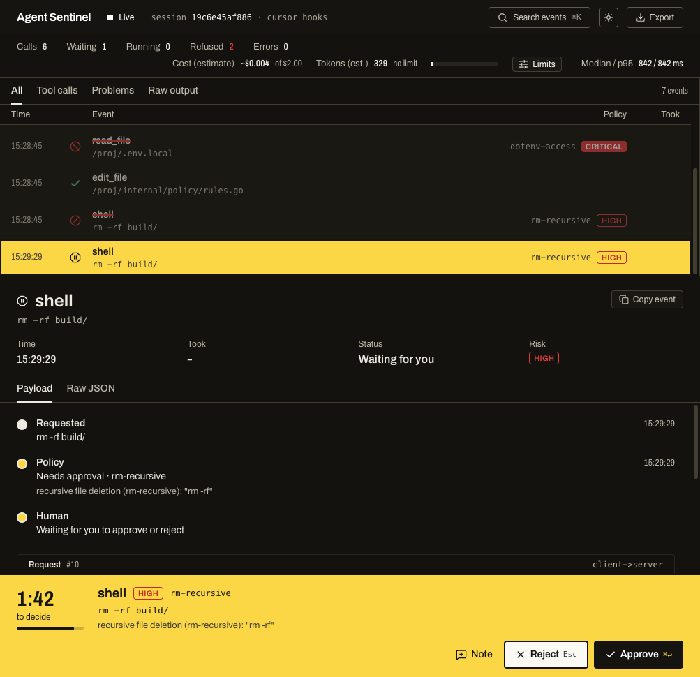

<div align="center">

# 🛡️ Agent Sentinel

**The local flight recorder on the stdio wire for MCP & custom agents.**

[](LICENSE)
[](https://go.dev)
[](https://modelcontextprotocol.io)
[](https://agent-sentinel-site.vercel.app)
[](https://agent-sentinel-site.vercel.app)

<br />

```
┌────────────────────────────────────────────────────────────────────────┐
│         CLIENT RUNTIME (Claude Code, Cursor Agent, Local LLMs)         │
└───────────────────────────────────┬────────────────────────────────────┘
                                    │ stdio / hooks (JSON-RPC 2.0)
                                    ▼
┌────────────────────────────────────────────────────────────────────────┐
│           AGENT SENTINEL (Transparent Wire Proxy & Boundary)           │
│  • Wire Inspector: Intercepts raw JSON-RPC requests & tool frames      │
│  • Policy Engine:  [ Allowed | Warned | Held for Approval ⌘↵ | Blocked]│
│  • Flight Recorder: Sessions saved locally (~/.sentinel/sessions/*.jsonl)│
│  • Spend Guard:    Dynamic token & USD session budget circuit breaker  │
│  • Local Cockpit:  Real-time visual monitoring on http://127.0.0.1:8848│
└───────────────────────────────────┬────────────────────────────────────┘
                                    │
                                    ▼
┌────────────────────────────────────────────────────────────────────────┐
│        UPSTREAM TARGETS (MCP Servers, Local Shell, Filesystem)         │
└────────────────────────────────────────────────────────────────────────┘
```

[Website & Live Docs](https://agent-sentinel-site.vercel.app) · [Setup Playbook for AI Agents](AGENTS.md) · [Architecture Blueprint](docs/ARCHITECTURE.md) · [Releases](https://github.com/zaninifrancesco/agent-sentinel/releases)

</div>

---

## ⚡ Overview

**Agent Sentinel** is a single self-contained Go binary that sits on the stdio wire between an AI coding agent and your operating system. It records what the agent does, measures execution latency in milliseconds, halts dangerous commands before they touch your filesystem, and renders the entire session in a local web cockpit.

- **100% Loopback & Zero Cloud:** Runs entirely on `127.0.0.1`. No telemetry leaks, no cloud accounts, no API proxy intermediaries.
- **Tested & Verified Live Integrations:** Natively supervises **Claude Code** and **Cursor Agent** via their respective hook lifecycle APIs, as well as **any MCP server** as a stdio proxy.
- **Single Static Executable:** Compiled with the React + Tailwind web cockpit embedded (`go:embed`). No Node.js or background daemon required in production.

<div align="center">
  
  <p><em>The Sentinel Cockpit: Real-time event timeline, token/latency telemetries, visual diff viewer, and human approval dock.</em></p>
</div>

---

## 🎯 Key Capabilities

| Capability | Category | Description |
| :--- | :--- | :--- |
| **🔍 Raw JSON-RPC Inspector** | *Wire Level* | Every `tools/call`, `tools/list`, notification, request payload, and response is intercepted and displayed in real time in the cockpit. No guesswork. |
| **⏱️ Latency & Traffic Telemetry** | *Performance* | Track precise millisecond execution times per tool call (p50 / p95). Spot lagging servers, token burn rate, and runaway loops before they drain machine resources. |
| **📼 JSONL Flight Recorder & Replay** | *Offline Replay* | Every session is saved locally to `~/.sentinel/sessions/*.jsonl`. Replay any past debugging session offline with `sentinel ui <session.jsonl>`. |
| **🛑 Execution Boundary & Policy** | *Safety Net* | When an unaligned or hallucinating model tries to wipe a directory, access `.env` secrets, or run git force-push, Sentinel halts or blocks it on the wire. |
| **💸 Cost & Token Circuit Breaker** | *LLMOps Guard* | Configurable session budget (tokens & USD). When the estimated threshold is reached, execution pauses until you approve a limit raise from the cockpit. |
| **📄 1-Click HTML Deliverable** | *Audit Hub* | Export a self-contained, zero-dependency HTML audit report to attach to GitHub Pull Requests or share with your engineering team. |

---

## 🛡️ The 4 Policy Verdicts

Every tool call and shell command evaluated by Sentinel receives one of four verdicts before execution:

* **✅ Allowed:** Safe call forwarded immediately to the MCP server or shell. Latency and payload recorded to the timeline.
* **⚠️ Warned:** Call executes but is flagged in the timeline to help you isolate model anomalies (e.g. `chmod 777`, suspicious environment assignments).
* **⏸️ Held for Approval:** Execution pauses on the wire while you review the raw parameters in the cockpit. Approve with **`⌘/Ctrl + Enter`** or reject with **`Esc`** and send a corrective steering note back to the model.
  *(Triggered by: `rm -rf`, `git push --force`, `git reset --hard`, `curl ... | sh`, `sudo`, destructive SQL, credential access).*
* **🚫 Blocked:** Never forwarded to the tool. The agent receives an immediate JSON-RPC refusal with the exact security rule violation.
  *(Triggered by: `.env` secret access, private SSH keys, `rm -rf /` or `~`, disk formatting).*

---

## 🤖 Supported Agents & Integrations

### 1. Claude Code *(Verified Live)*
Sentinel supervises Claude Code natively through its lifecycle hooks in `.claude/settings.local.json`:
- **Pre-execution evaluation:** File writes (`Write`, `Edit`, `MultiEdit`) are judged **before** the write occurs, allowing Sentinel to block or hold dangerous edits.
- **Respects Claude permissions:** Sentinel only objects to risky calls. Safe calls receive no answer from Sentinel so Claude Code's native permission prompts continue to function normally.
- **Accurate interrupt handling:** Interrupted or declined commands are cleanly closed as `interrupted`.

### 2. Cursor Agent *(Verified Live)*
Supervises Cursor background terminal sessions and tool invocations via `.cursor/hooks.json`:
- Intercepts shell executions (`beforeShellExecution`, `afterShellExecution`) and file access (`beforeReadFile`).
- Records file diffs post-edit and flags exposed credentials.
- Automatic offline fallback: asks for human confirmation if `sentinel serve` is paused.

### 3. Any Model Context Protocol (MCP) Server
Wrap any standard stdio MCP server (e.g. `@modelcontextprotocol/server-filesystem`, `@modelcontextprotocol/server-postgres`):
- Operates as a transparent middleware proxy inspecting JSON-RPC 2.0 frames on the wire.

---

## 🚀 Installation & Quickstart

### Option A: Let your AI Agent set it up (Recommended)
Copy and paste this prompt to **Claude Code** or **Cursor**:

> *"Install and set up Agent Sentinel for this project. Follow the official setup playbook at https://github.com/zaninifrancesco/agent-sentinel/blob/master/AGENTS.md: check Go/Node prerequisites, run `make install`, start `sentinel serve`, configure the hooks for my environment, and verify that commands appear on the cockpit at http://localhost:8848."*

---

### Option B: Prebuilt Binary (macOS & Linux)

Download the archive for your architecture from the [Latest Releases](https://github.com/zaninifrancesco/agent-sentinel/releases):

```bash
# Example for macOS Apple Silicon:
tar -xzf sentinel_*_darwin_arm64.tar.gz
mkdir -p ~/.sentinel/bin
mv sentinel_*/sentinel ~/.sentinel/bin/
export PATH="$HOME/.sentinel/bin:$PATH"

# macOS quarantine removal if downloaded via browser:
xattr -d com.apple.quarantine ~/.sentinel/bin/sentinel
```

---

### Option C: Build from Source

Prerequisites: Go 1.27+ and Node.js 20.19+ (or 22.12+):

```bash
git clone https://github.com/zaninifrancesco/agent-sentinel.git
cd agent-sentinel
make build      # Compiles React cockpit, then builds bin/sentinel
make install    # Copies executable to ~/.sentinel/bin/sentinel
```

---

## 💻 Usage Playbooks

### With Claude Code

```bash
cd your-project

# 1. Install Sentinel hooks into .claude/settings.local.json
sentinel hook install --agent claude

# 2. Start the local background supervisor & open the cockpit
sentinel serve --open    # Opens http://127.0.0.1:8848

# 3. Launch Claude Code in another terminal
claude
```

---

### With Cursor Agent

```bash
cd your-project

# 1. Install Sentinel hooks into .cursor/hooks.json
sentinel hook install

# 2. Start the local supervisor
sentinel serve --open

# 3. Use Cursor Agent as usual — all actions stream into the cockpit!
```

---

### In Front of an MCP Stdio Server

```bash
# Wrap an MCP server with the live Sentinel cockpit
sentinel mcp --ui -- npx -y @modelcontextprotocol/server-filesystem .
```

---

### Replay a Past Session

```bash
sentinel ui                           # Replay latest recorded session
sentinel ui ~/.sentinel/sessions/*.jsonl # Replay specific session
```

---

## ⌨️ Cockpit Shortcuts & Controls

The Sentinel cockpit is designed keyboard-first:

| Shortcut / Control | Action |
| :--- | :--- |
| **`⌘/Ctrl + Enter`** | **Approve** the held action and resume agent execution |
| **`Esc`** | **Reject** the held action and send feedback back to the agent |
| **`J` / `K`** or **`↓` / `↑`** | Navigate through timeline events |
| **`⌘K` / `Ctrl+K`** | Open the **Command Palette** to search events or jump to errors |
| **`Limits` button** | Dynamically adjust or remove the token and USD cost limit |
| **`Export` button** | Generate a standalone, single-file HTML audit report |

---

## ⚙️ CLI Reference

```text
Usage:
  sentinel serve [--open] [--port 8848] [--policy FILE] [--max-cost USD]
      Run local cockpit and supervise agents via hooks.

  sentinel hook [--offline allow|ask|deny]
      Internal hook worker invoked by Cursor or Claude Code.

  sentinel hook install [--agent cursor|claude] [--dir PATH] [--user]
      Register Sentinel in .cursor/hooks.json or .claude/settings.local.json.

  sentinel hook uninstall [--agent cursor|claude] [--dir PATH] [--user]
      Cleanly unregister Sentinel hooks.

  sentinel mcp [--ui] [--port 8848] -- <server-command> [args...]
      Transparently proxy a stdio MCP server.

  sentinel ui [SESSION_FILE.jsonl]
      Replay a recorded session in the cockpit.
```

---

## 🛠️ Development & Architecture

```bash
make test                  # Run go vet and unit tests with -race
make dev-web               # Launch Vite frontend with hot reload
cd web && npm run typecheck # Verify TypeScript strict types
```

For deeper architectural context:
* [Architecture Blueprint](docs/ARCHITECTURE.md) — System topology, PTY vs hook rationale, and event schemas.
* [Product Specification](PRODUCT.md) — Product purpose, constraints, and operating principles.
* [Agent Setup Playbook](AGENTS.md) — Canonical step-by-step setup procedure for AI agents.

---

## 📄 License

MIT © [Francesco Zanini](https://github.com/zaninifrancesco). See [LICENSE](LICENSE) for details.
