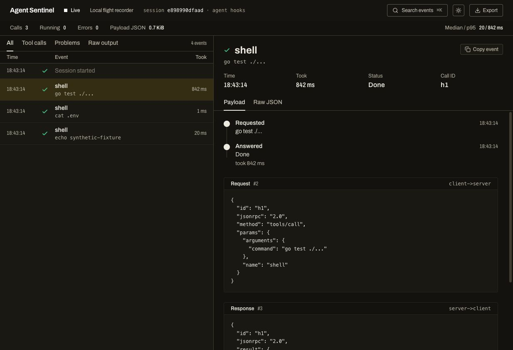

# Agent Sentinel

**The Local Profiler & Flight Recorder for AI Agents.**

Agent Sentinel records coding-agent hooks and MCP stdio traffic in a local cockpit. Inspect tool calls, arguments, responses, errors, available durations and patches; save the recording and inspect it again offline.

A single Go executable embeds the web UI. Recording and inspection require no cloud account, API key, Docker service or external database. Sentinel does not send recordings to remote services. Your coding agent and MCP servers may still use the network independently.

## Development status

This branch starts the telemetry pivot with **passive capture**. Sentinel no longer evaluates command policies, holds calls for approval or enforces spending limits. The coding agent's own permissions still apply.

Available now:

- Passive Cursor and Claude Code hooks, with neutral responses even if the collector is offline.
- A bounded hook-delivery deadline: one second by default, configurable up to five seconds.
- MCP stdio proxying without a policy gate; requests and responses are forwarded unchanged.
- A paged call waterfall with one lane per call, visible overlaps and unattributed intervals. Matched capture coverage uses interval union; reported tool duration remains separate.
- A tool profile with per-tool activity, longest completed calls and largest retained responses, each linked to its captured evidence.
- A call inspector with status/tool filters, full-argument search, duration/response-size sorting, payload text search, previous/next navigation, available patch diffs and a separate event log.
- Recording-scoped call identities and separate agent sessions/connections, with a cockpit scope selector.
- Explicit native/fallback pairing, ambiguous-call filtering and orphan responses preserved in Event log.
- Shared Go metrics for live, replay and export: call/error counts, nearest-rank percentiles, retained JSON, capture coverage and peak observed concurrency.
- Versioned profiler API with stable snapshot cursors, 50-row cockpit pages, server-side search/sorting and payloads fetched only for the selected call.
- Capture profiles with limits and transformation metadata: observed source bytes, normalized/stored JSON, redaction, truncation and omission, visible in the inspector and report.
- Local JSONL recordings and read-only replay, including older enforcement traces.
- Standalone HTML session reports, without scripts or external assets.

**Planned, not implemented yet:** native model/turn spans, bounded queues and capture-gap recovery, repeated-call findings, schema diagnostics and a recording catalog. See the [implementation roadmap](docs/ROADMAP.md).



This screenshot uses a synthetic JSONL recording from the earlier Trace Atlas build, before the graphite sidebar and session selector. No command shown in it was executed by the fixture generator. The previous enforcement cockpit is retained in `docs/cockpit.png` as historical material.

## Build

Build prerequisites: Go 1.27+ and Node.js 20.19+ or 22.12+.

```bash
make build
./bin/sentinel version
./bin/sentinel help
```

For an installation, `make install` builds the embedded cockpit and copies the executable to `~/.sentinel/bin/sentinel`. Hook entries store its absolute path, so choose the final binary before installing hooks. Building this checkout is separate from replacing an existing installed binary.

An installed executable needs neither Go nor Node.js to run. Source builds use npm to obtain build dependencies; recording, replay and reports do not require a network connection.

## Record a coding agent

Choose the project you want to observe. Installing inside the Sentinel source tree only observes agents working in that tree.

First start the collector in a background terminal or process:

```bash
~/.sentinel/bin/sentinel serve --mode observe
```

It prints a session ID, JSONL path and cockpit URL: `http://127.0.0.1:8848`. Check the active mode before connecting hooks:

```bash
curl -sf http://127.0.0.1:8848/api/config
```

Expected: `"mode":"observe"`, `"approvals":false`, `"budgetEditable":false`, `"policy":"off"`.

Install for one agent in the target project:

```bash
# Cursor
~/.sentinel/bin/sentinel hook install --dir /path/to/project

# Claude Code
~/.sentinel/bin/sentinel hook install --agent claude --dir /path/to/project
```

Run only the command for the chosen agent. Install preserves other hooks and settings; running it again replaces Sentinel's entries rather than duplicating them. New entries include `hook --mode observe` and a six-second process timeout, allowing a margin around the client's delivery deadline.

Cursor reloads its hook file on change; if it has not loaded, reopen the project. Restart Claude Code after installation, because it loads hooks at session start.

MCP hooks are opt-in with `hook install --mcp`. Use either those hooks or the MCP proxy for the same traffic to avoid recording it twice. `--user` explicitly installs for all projects instead of one.

For the complete ordered setup and a synthetic verification, follow [AGENTS.md](AGENTS.md).

## Record an MCP stdio server

```bash
~/.sentinel/bin/sentinel mcp --ui -- /path/to/mcp-server arg1
```

The proxy writes protocol traffic to stdout and its own diagnostics to stderr. It does not modify tool permissions or server results. A proxy/server process failure can still interrupt the stdio connection.

Without `--ui`, it records without opening a cockpit listener. Use `--log /path/to/trace.jsonl` for a chosen log or `--log -` to disable file logging.

## Capture profiles

`serve` and `mcp` default to `--capture standard`: recognized sensitive fields and text patterns are redacted before storage and streaming; each retained payload is limited to 64 KiB of JSON. This is best-effort recognition, not a guarantee that every secret is removed. Standard capture also omits read contents and summarizes some hook results.

Choose `--capture full` explicitly to retain more of the supplied hook content, without redaction and with a default limit of 1 MiB per payload. It cannot recover content omitted or shortened before it reached the collector. Both profiles accept `--max-payload-bytes N` (256–16,777,216 bytes; zero selects the profile default).

```bash
~/.sentinel/bin/sentinel serve --capture standard --max-payload-bytes 32768
~/.sentinel/bin/sentinel mcp --capture full --ui -- /path/to/mcp-server
```

The selected settings are saved in the recording and exposed by `/api/config`. Limits apply to the retained payload value, not the whole event, incoming transport, queues or total recording memory. The MCP bytes forwarded to the agent/server are unchanged. Existing recordings are replayed as stored; replay does not apply the new redaction policy retroactively.

## Replay and export

```bash
~/.sentinel/bin/sentinel ui
~/.sentinel/bin/sentinel ui /path/to/trace.jsonl
```

The first opens the latest recording; the second opens the selected file. Replay never executes captured commands. Historical blocks, holds and human decisions remain visible in old recordings, without approval controls.

The cockpit's Export button uses a backend snapshot and always exports the whole recording, including all captured sessions and connections. It downloads an offline HTML report with summary figures, capture settings, payload-coverage summaries and expandable call history. It includes argument summaries, not full request/response payloads. The original JSONL is the trace for detailed local replay; a dedicated JSONL export flow is planned. `sentinel export` and `sentinel run` are not implemented.

A synthetic multi-session recording is included at [`testdata/telemetry-v2.jsonl`](testdata/telemetry-v2.jsonl): seven observed requests, two ambiguous responses, one orphan response and one synthetic interruption. Open it with `sentinel ui testdata/telemetry-v2.jsonl`; its command strings were never executed.

The profiler loads 50 call summaries per page. Next/previous pages stay pinned to the same recording revision while new events arrive; Refresh latest returns to current evidence. The inspector fetches one selected call's retained payloads. See the [profiler API contract](docs/PROFILER_API.md).

## What the numbers mean

Durations are those available from the adapter or proxy; they are not the model's thinking time. Median and p95 include completed tool calls with available nonnegative durations, excluding interrupted calls and legacy approval-held spans. Zero milliseconds is valid; absent samples display as unavailable.

**JSON retained** sums stored request and matched-response payload JSON bytes for the selected recording scope, independently of list filters or pagination. Unassigned responses are excluded. Legacy recordings use compact retained payload JSON where a stored measurement is absent. Some hook payloads are synthesized, omitted or truncated. This is neither original wire volume nor actual model tokens or context usage. Sentinel no longer calculates dollars from fixed token-price assumptions.

Matched coverage is the union of valid captured tool intervals. Unattributed time is the remainder of the observed recording span; it can include model, user, scheduling and missing evidence. Pending or ambiguous calls and synthetic closures stay points. These measures never infer model thinking time or native context usage.

New JSONL events use schema v2, retaining `sessionId` as the recording identity for compatibility. Native IDs keep their type and exact value unless standard capture recognizes a credential-like string: those identities become stable opaque values within the recording, with affected fields declared. An ambiguous response is never assigned to an arbitrary request. Missing requests are not fabricated. Duration provenance and explicit zero are preserved in `timing`; synthetic turn-end closures have no execution duration.

The inspector distinguishes the adapter's observed source value (a named text/JSON field or MCP frame), normalized JSON and stored JSON. Hook-client reported sizes remain separate from collector measurements. Completeness applies to that source value, not the entire model conversation; legacy original sizes stay unknown. Current logs do not reconstruct full model context, task boundaries or workspace state. Capture-gap diagnostics remain planned. Local recordings can contain commands, source text and tool output; inspect them before sharing.

## Migrating from enforcement releases

This is a behavior change. The new default is observation only; `--mode observe` makes that explicit. If you need the previous command-blocking behavior, keep the previous release.

The new CLI rejects `--policy`, `--max-cost`, `--approval-timeout` and `--offline` with migration guidance instead of silently ignoring them. Stop the old collector before starting the new one and explicitly reinstall Sentinel's hooks for each project you migrate. A new hook never forwards a legacy collector's permission decision to the agent; it returns neutrally and reports an unexpected decision on stderr.

Do not rebuild over an executable referenced by active hooks during normal development. Replacing that executable changes every project using it even if the hook files remain unchanged. Prepare and test the new build separately; perform the installed-binary replacement and hook migration only as an explicit upgrade.

Stopping the new collector loses telemetry while it is offline but does not add Sentinel confirmation prompts. Hook delivery errors are reported on stderr and acknowledged neutrally.

## Remove integration

```bash
~/.sentinel/bin/sentinel hook uninstall --dir /path/to/project
~/.sentinel/bin/sentinel hook uninstall --agent claude --dir /path/to/project
```

Use the command matching the installed agent, then stop the collector. Only Sentinel's entries are removed.

## Development checks

```bash
make test       # Go vet, race tests, frontend typecheck and telemetry/report tests
cd web
npm run build  # Typecheck and build the embedded UI
```

[Product direction](docs/PRODUCT_DIRECTION.md) · [Architecture](docs/ARCHITECTURE.md) · [Telemetry contract](docs/TELEMETRY_SPEC.md) · [Analysis specification](docs/ANALYSIS_SPEC.md) · [Roadmap](docs/ROADMAP.md) · [Progress](docs/PROGRESS.md)

MIT © Francesco Zanini. See [LICENSE](LICENSE).
