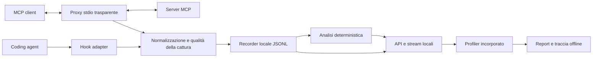

# Architettura — profiler locale e flight recorder

Stato: specifica di destinazione, 15 ottobre 2026. Questo documento sostituisce il precedente blueprint. La distinzione tra implementato e previsto è parte del contratto.

## 1. Base attuale verificata nel repository

- `cmd/sentinel/serve.go` avvia il server locale e un recorder per gli hook; configura ancora policy, budget e broker di approvazioni.
- `cmd/sentinel/hook.go` inoltra gli hook al server. Oggi il fallback predefinito è `ask` e il client non ha un timeout complessivo perché può attendere approvazioni.
- `internal/cursorhooks/handler.go` e `claude.go` normalizzano gli hook in eventi simili a chiamate MCP. Alcuni payload sono sintetici, non frame MCP realmente transitati. Gli output vengono limitati a 64 KiB; alcuni contenuti letti vengono omessi o ridotti prima della registrazione.
- `internal/proxy` inoltra frame MCP stdio, correla richieste e risposte e applica ancora il gate di policy/budget. La durata osservata attraversa il percorso proxy; non è una misura interna del server o del modello.
- `internal/recorder` mantiene gli eventi in memoria e li scrive in JSONL. `SessionID` identifica la registrazione del processo Sentinel, non una sessione dell'agente normalizzata. Gli errori del sink non sono esposti e un subscriber lento può perdere eventi live senza una segnalazione esplicita.
- `internal/server` espone una sola registrazione tramite `/api/session`, `/api/events`, `/api/config` e `/ws`, oltre agli endpoint di hook, budget e approvazioni. Lo stream inizia con uno snapshot.
- `web/src/useSentinel.ts` costruisce le righe correlando soprattutto `rpcId`; `metrics.ts` calcola le metriche nel browser. Token e costi derivano dalla dimensione JSON dei payload, con euristica e prezzi fissi: non sono usage del modello.
- Il cockpit ispeziona payload e patch presenti nei dati; non conserva snapshot completi del workspace. Il report HTML attuale è autonomo, senza script, con dettagli espandibili e senza payload completi.
- Il replay JSONL esiste. Non esistono `sentinel run`, `sentinel export`, un catalogo multi-sessione o un motore di findings.

Questi elementi sono il punto di partenza, non il risultato del pivot.

## 2. Architettura di destinazione

Il percorso di esecuzione passa attraverso il proxy quando necessario al trasporto, ma non attraverso policy, findings o UI. Un'anomalia diagnostica non modifica la richiesta, la risposta o i permessi dell'agente.

La prima versione continua a usare Go, JSONL e frontend incorporato. Nessun SQLite, servizio collector separato o database esterno è un prerequisito. Un indice ricostruibile dai file è sufficiente per selezionare le sessioni; la paginazione deve evitare il caricamento di tutta la storia nel browser.

Il collector locale mantiene come indirizzo predefinito `http://127.0.0.1:8848`. Il pivot non richiede di cambiare porta o introdurre un servizio remoto.

## 3. Separazione delle responsabilità

### Adattatori di cattura

Gli adattatori conoscono i payload dell'agente o del trasporto e dichiarano le proprie capability. Estraggono identità native, timestamp, argomenti, risultati e limiti noti. Non decidono se un comportamento è sbagliato.

Un payload normalizzato da hook va etichettato come tale. La vista «raw MCP» è disponibile solo se un frame MCP è stato effettivamente acquisito. Conservare l'input originale dell'hook segue le stesse regole di redazione e conservazione degli altri payload.

L'installazione resta responsabilità della CLI: merge idempotente dei soli hook Sentinel, conservazione degli altri hook e rimozione selettiva. Nessuna modifica automatica delle integrazioni durante la lettura di una traccia.

### Recorder e store

Il recorder assegna sequenze e identità, conserva i metadati di cattura e rende visibili errori di persistenza, perdita di eventi e limiti di memoria. Il formato e la compatibilità sono definiti nel [contratto di telemetria](TELEMETRY_SPEC.md).

La raccolta usa code limitate. Un sink lento non può trattenere indefinitamente una chiamata dell'agente. Quando la capacità è esaurita, il prodotto degrada la cattura e segnala l'intervallo perso; non dichiara una traccia completa. Il flush alla chiusura ha un limite finito.

Un browser lento non rallenta il recorder. La UI recupera i gap dallo store quando possibile. «Non visto nello stream» e «non persistito» sono condizioni distinte.

### Motore di analisi

Proposta: package Go `internal/analysis`, indipendente da HTTP, UI e policy. Riceve eventi normalizzati ordinati, capability e versione delle regole; produce metriche e findings con riferimenti agli eventi.

L'analisi è derivata, ricalcolabile e separata dalle evidenze originali. Lo stesso input, con gli stessi parametri e la stessa versione, produce lo stesso risultato in live, replay ed export. Nessun servizio LLM nella prima release.

### API locale e profiler

L'API serve sessioni, chiamate, metriche, findings e dettagli dei payload. L'interfaccia applica filtri e presenta risultati; non mantiene una seconda implementazione degli algoritmi di analisi.

La UI presenta waterfall, graduatorie dei payload, errori e findings, con accesso al dettaglio e copertura dei dati. Approvazioni e budget non occupano il percorso principale. Un vecchio log conserva una lettura storica dei verdict.

Le difese già presenti per host, origin e contenuti non fidati restano pertinenti: il cockpit contiene codice e output locali. Eliminare il gate dei comandi non significa esporre i dati a siti estranei.

## 4. Comportamento passivo e guasti

- Hook online: risposta neutra secondo il contratto dell'agente. Per Claude Code non introdurre `allow` che salti la sua conferma nativa. Verificare i contratti con fixture prima di cambiare le risposte.
- Hook offline, recorder indisponibile o timeout: nessuna conferma aggiuntiva introdotta da Sentinel; restituzione neutra entro un limite finito e diagnostica su stderr, senza sporcare stdout.
- Proxy: inoltro di byte e risposte senza riscritture da parte dell'analisi. Gli errori di cattura possono degradare la registrazione mentre il trasporto continua, quando tecnicamente possibile.
- Un crash del proxy o del server MCP può interrompere il collegamento: non promettere continuità se il processo che gestisce stdio termina. Distinguere questi guasti dalle decisioni di policy, che il nuovo percorso non prende.
- Schema non valido: registrare una diagnosi; non correggere, respingere o simulare la risposta del tool.
- Payload oltre il limite: inoltro intatto nel proxy; solo la copia registrata può essere ridotta con metadati espliciti. L'adattatore non può conservare ciò che la sorgente non invia.
- Chiusura senza risposta: chiamata incompleta; usare `interrupted` solo con evidenza di interruzione, altrimenti `unknown`. Non inventare successo, timeout o durata di esecuzione.

I timeout della raccolta non sono timeout del tool. Le code e i limiti scelti devono essere misurati nel lavoro di implementazione, non presentati come benchmark già ottenuti.

## 5. Sessioni e concorrenza

Una registrazione può ricevere più conversazioni. Separare `recordingId`, `agentSessionId`, `turnId` quando disponibile, `connectionId` e `callId`. Una risposta non si correla per solo nome del comando o `rpcId` globale.

I confini del processo collector non diventano automaticamente confini del task. Il `stop` di un agente non conclude altre conversazioni. Alla ripartenza, ID riutilizzati da una sorgente devono essere isolati da una nuova identità di connessione/istanza.

Il proxy standalone e il collector degli hook possono produrre registrazioni separate nella prima release. Non è necessario farli confluire in un unico daemon o sulla stessa porta. Il replay deve poter aprire entrambe; la correlazione automatica tra le due fonti è rimandata e non deve duplicare chiamate nelle metriche.

Configurare una sola fonte primaria per lo stesso traffico MCP: proxy oppure hook MCP. Se entrambe sono presenti, presentarle separatamente e non sommarle in un totale unico senza una deduplicazione dimostrabile.

## 6. Compatibilità e migrazione

Il lettore riconosce i JSONL senza versione come formato precedente e li adatta senza riscriverli. I campi non recuperabili restano sconosciuti. Gli eventi di approvazione e budget sono conservati per spiegare la storia di quella registrazione.

L'API di destinazione aggiunge una versione e capability; il contratto HTTP dettagliato va fissato nella fase del modello dati. Gli endpoint esistenti non diventano multi-sessione solo cambiandone il contenuto in modo implicito.

Le opzioni di policy e budget esistenti non possono essere accettate e ignorate silenziosamente. La migrazione deve spiegare che il nuovo percorso è osservativo, mentre quello precedente offriva controlli. Nessuna reinstallazione automatica degli hook.

## 7. Export e riproducibilità

Il JSONL è l'evidenza ricaricabile; il report HTML è una rappresentazione consultabile offline. Entrambi devono includere stato della cattura, versione dello schema e dell'analisi e limiti dei dati disponibili.

Il report può usare `
` nativi e collegamenti interni, senza JavaScript obbligatorio. Deve mantenere escaping e CSP, non includere risorse remote e non eseguire contenuti catturati. La selezione dei payload da condividere è esplicita; esportare un report non abilita upload o invii esterni.
